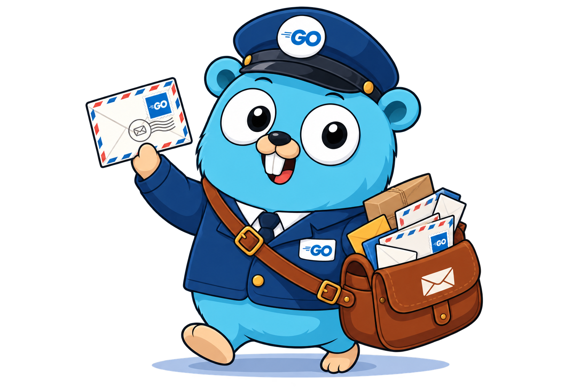

<div align="center">
    
    <h1>Golang ВК почтавик</h1>
    Go бот для перессылки почты в чат VkTeams, через VkTeamsBotApi в связке с Go-imap
</div>

# 🚀 Методы запуска

## 🐳 Docker

### Склонируйте проект
```bash
git clone https://github.com/tinfld/Postal_VK_Bot.git
```

### В папке проекта создайте файл окружения *.env* с переменными
```
BOT_TOKEN=""
IP_MAIL=""
MAIL_USER=""
PASSWORD_USER=""
CHAT_ID=""
```

### Выполните в корне проект запуск *Docker compose*
```bash
docker compose up -d --build
```

### В случае постоянного перезапуска контейнера
```
 ✔ Container postal_vkbot-bot-1 Recreated                                                                           0.1s
Attaching to bot-1
bot-1 exited with code 0 (restarting)
bot-1 exited with code 0 (restarting)
bot-1 exited with code 0 (restarting)
bot-1 exited with code 0 (restarting)
bot-1 exited with code 0 (restarting)
bot-1 exited with code 0 (restarting)
bot-1 exited with code 0 (restarting)
```

### Проверьте логи, и убедитесь что файл окружения заполнен правильно
```bash
docker compose logs -f
```

## 💻 Локальный запуск

### Для локального запуска 

### Склонируйте проект
```bash
git clone https://github.com/tinfld/Postal_VK_Bot.git
```

### Выполните установку зависимостей 
```bash
go mod download
```

### В папке проекта создайте файл окружения *.env* с переменными
```
BOT_TOKEN=""
IP_MAIL=""
MAIL_USER=""
PASSWORD_USER=""
CHAT_ID=""
```

### Выполните запуск приложения 
```bash
go run .
```

